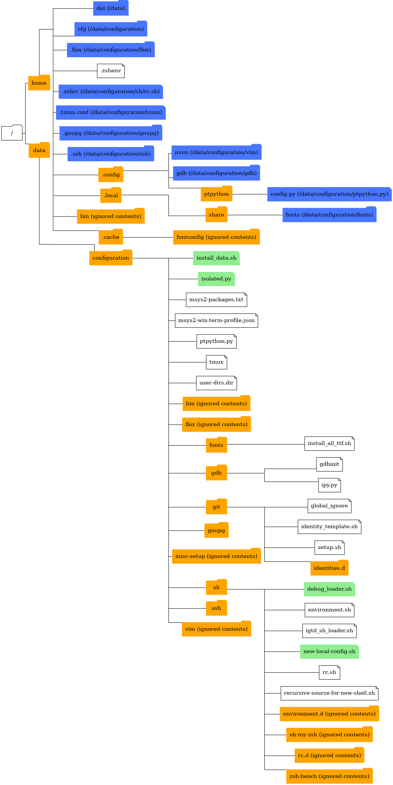

# Configuration Files

My framework for my configuration/dot files.

## Setup

### Setup Environment Variables

| Name | Default | Description |
| --- | --- | --- |
| `install_data` | `$DATA` or `/data` | |
| `install_home` | `$HOME` | |
| `install_xdg_config_home` | `$XDG_CONFIG_HOME` or else `$install_home/.config` | |
| `install_xdg_data_home` | `$XDG_DATA_HOME` or else `$install_home/.local/share` | |
| `install_user_dirs` | `true` | Create and link replacements for common home directories in `$install_data` |
| `set_ssh_origin` | `true` | Set SSH origin for git repo |
| `MSYS` | N/A | See below |

These are saved to `install_saved_vars.sh`.

### Linux Setup

- Install [Flox](https://flox.dev/docs/install-flox/)
- Make sure these programs are installed:
    - Zsh
    - GnuPG
    - git
    - Optionally:
        - xclip
        - ptpython
        - ipython
        - xdg-open
    - On Ubuntu/Debian:
        - `sudo apt install zsh gnupg git xclip ptpython ipython3 xdg-utils`
- Create (or mount) `/data` (or whatever `$install_data` is)
    - `sudo mkdir /data`
    - `sudo chown $USER:$USER /data`
- Place/clone this repository at `/data/configuration`.
    - `cd /data`
    - `git clone --recurse-submodules https://github.com/iguessthislldo/configuration`
    - `cd configuration`
- `bash install_data.sh` to do the initial setup, clearing existing default
  stuff in the home directory and repeating the command as necessary until
  it's able to finish.
- The following items require the system to restart and/or the user to relogin,
  so the system can restarted after doing all of them:
    - Set Zsh as the default shell, for example: `chsh -s /usr/bin/zsh`
    - Install [Flatpak](https://flathub.org/en/setup)
    - Run `misc-setup/setup-latptop.sh` if applicable
    - Restart the system
- If copying from an existing `/data` on a source system:
    - To copy files using SSH:
        - Make sure an SSH server is installed and running on the source
          system.
        - Run `bash install_data.sh import HOST` on the destination system.
    - To copy files manually:
        - Run `bash install_data.sh export` on the source system.
        - Copy **`/data/configuration/export.txz` to `/data/export.txz`** on
          the destination system.
        - Run `bash install_data.sh import` on destination system.
    - `bash install_data.sh` one final time to have it take up the imported
      files.
- Run `sync-flatpak` if Flatpak was installed:
    - To use `sync-flatpak`, the libflatpak GI bindings are needed. On
      Ubuntu/Debian these can be installed using `sudo apt install gir1.2-flatpak-1.0`
    - Use `sync-flatpak list` to see the groups and apps
    - Use `sync-flatpak sync` to install all the default apps and
      `sync-flatpak sync --add-groups <group1>,<group2>,...` to include
      optional groups and install the apps
    - Use `sync-flatpak export <app>...` export apps from an existing
      system, copy `export-flatpak-data.txz` to the new system, and
      run `sync-flatpak import` to import on the new system.
- Set terminal font if desired.
- Run `(cd ~/cfg/git && bash setup.sh)` to setup Git.

#### Rest of Setup

Run scripts in `misc-setup` as needed.

- If the destination system is running a SSH server you're using to do this, it
  could make new logins impossible: (`Permission denied (publickey)`) because
  the `.ssh` directory was replaced with a symlink. `.ssh` has to stay a normal
  directory: Run `$CONFIG/misc-setup/copy-ssh.sh` to copy everything and make
  sure the permissions are good.
- Run `$CONFIG/misc-setup/exclusive-perms.sh $CONFIG/gnupg` if GnuPG has
  problems signing git commits.

### MSYS2 Setup

- **NEEDS MORE WORK**
    - Neovim:
        - Does not work with shortcut-based links
    - Git
        - Git id after import isn't correct
        - Line endings
    - Something to check if `msys2-packages.txt` changed and offer to install
      or remove them automatically would be nice.

- [Install MSYS2](https://www.msys2.org/wiki/MSYS2-installation/)
- Open MSYS2 UCRT64 Shell
- Decide on symlink kind (**MSYS2 default is deep copy!**):

  See [more info on symlinks](https://www.msys2.org/docs/symlinks/).

  - Native-based:
    - Windows needs to be put into "developer mode" (requires admin) to enable native links.
    - `export MSYS=winsymlinks:nativestrict`
  - Shortcut-based:
    - Works in explorer, but kinda a kludge, and doesn't work sometimes (neovim).
    - `export MSYS=winsymlinks:lnk`
- Update and install essentials:

  ```shell
  pacman -Syu
  pacman -S --needed git zsh
  ```

  Might need to [export a certificate for MSYS2 to use](
  https://stackoverflow.com/questions/69348953/certificate-error-when-trying-to-install-msys2-packages-on-windows-server)
  on cooperate network. Might need to rename the certificate after exporting.
- Create a `data` directory:

  ```shell
  mkdir data
  cd data
  export install_data=$(realpath .)
  ```
- Place/clone this repository at `data/configuration`:

  ```shell
  git clone --recurse-submodules https://github.com/iguessthislldo/configuration
  cd configuration
  ```
- Install list of packages:

  ```shell
  pacman -S --needed - < msys2-packages.txt
  ```
- Set remaining values and run `install_data.sh` until it succeeds.

  ```shell
  export install_xdg_config_home=$(cygpath --unix "$LOCALAPPDATA")
  export install_xdg_data_home=$(cygpath --unix "$LOCALAPPDATA")
  export install_user_dirs=false
  bash install_data.sh
  ```
- Decide on terminal:

  See [more info on terminals](https://www.msys2.org/docs/terminals/)

  - Bundled Mintty:
    - Works, but it doesn't have the nerd font unless installed and selected, so fonts are broken.
  - Windows Terminal:
    - Also no nerd font out of the box.
    - Run `misc-setup/set-msys2-win-term-profile.sh`
  - WezTerm:
    - Has nerd font builtin.
    - Download [WezTerm](https://wezterm.org/).

## Example Directory Structure After Install

Run `isolated.py --create --clone isoenv true` and
`isolated.py isoenv --graph` to regenerate from committed. Requires Graphviz.



## Usage

### Aliases and Scripts Added to `PATH`

This doesn't include `sh/rc.d/50_aliases.sh` or aliases added by oh-my-zsh.

#### `u`

Usage: `u [COUNT]`

Move up COUNT number of directories, like `cd (../)*COUNT`. COUNT is 1 by
default.

#### `e`

Usage: `e [ARGS...]`

Python script that passes arguments through to `$EDITOR`.

If the `$EDITOR` has `vi` in the name, then it assumes it's vi-compatible and
will change arguments of the form `FILENAME:NUMBER` to `FILENAME +NUMBER`.

#### `gitid`

Set predefined git commit identity information for a repository.

See `gitid -h` for usage.

TODO: Info on how to setup identities

#### `makej`

Usage: `makej [ARGS...]`

Run `make` with `ARGS`, but also pass `-j` and the number of CPU cores plus 1.

#### `activate`

Command checks the current directory and all of its parents for a Python
virtualenv, and starts an instance of the current shell with that virtualenv
activated.

#### `add-to-bin`

Usage: `add-to-bin REAL_FILE [NAME]`

Creates a symlink in `~/bin` pointing to `REAL_FILE`. If `NAME` is given, the
symlink will use that name instead of the file's basename.

#### `sync-flatpak`

Usage: `sync-flatpak <command> [OPTIONS]`

Sync Flatpak applications across machines using flatpakref files. Requires the
libflatpak GI bindings (e.g. `gir1.2-flatpak-1.0` on Ubuntu/Debian).

Commands:
- `list` - List synced and installed apps without making changes.
- `sync` (default) - Install missing synced apps, decide what to do with
  unsynced installed apps, and uninstall removed apps.
  - `--ignore APP`, `-i APP` - Ignore an app so it is not installed or synced.
  - `--unignore APP` - Stop ignoring a previously ignored app.
  - `--add-groups [APP:]GROUP,...` - Add groups globally or to a specific app.
  - `--rm-groups [APP:]GROUP,...` - Remove groups globally or from a specific
    app.
- `export APP[:KIND,...]...` - Export app data to `export-flatpak-data.txz`.
  Kinds: `config`, `data`, `cache`, `state`, `perms`, `all` (default:
  `config,data,state,perms`).
- `import [APP...]` - Import app data from `export-flatpak-data.txz`.
